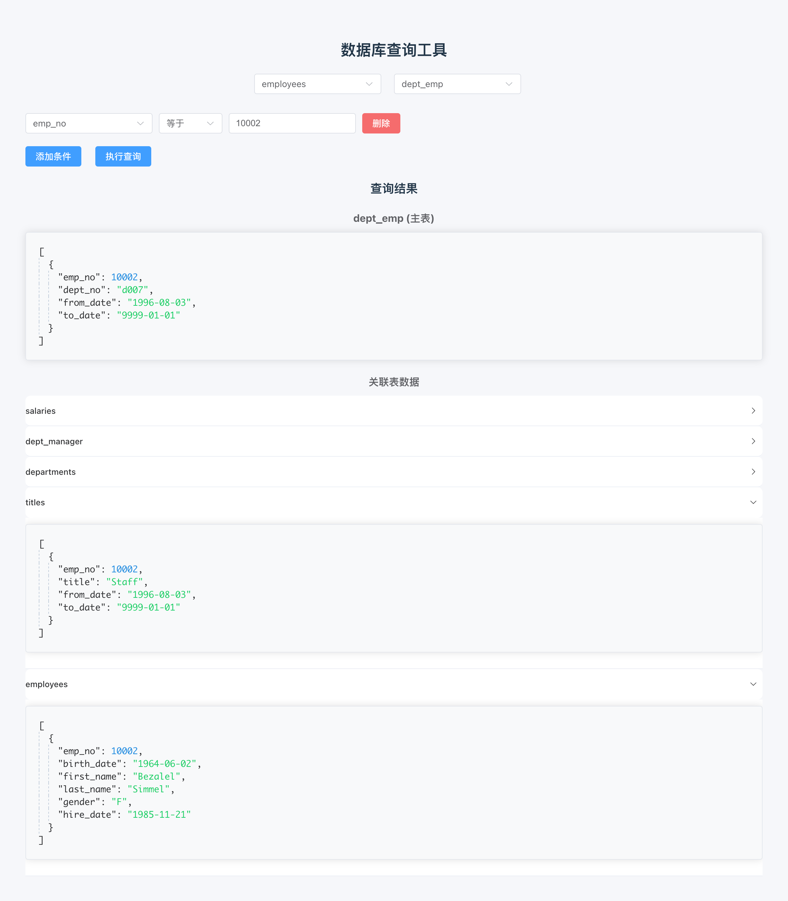
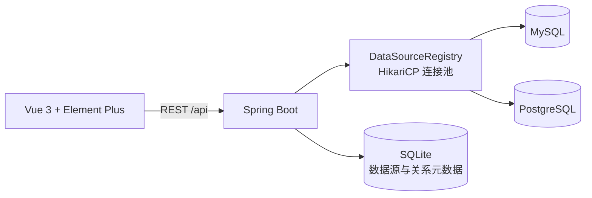
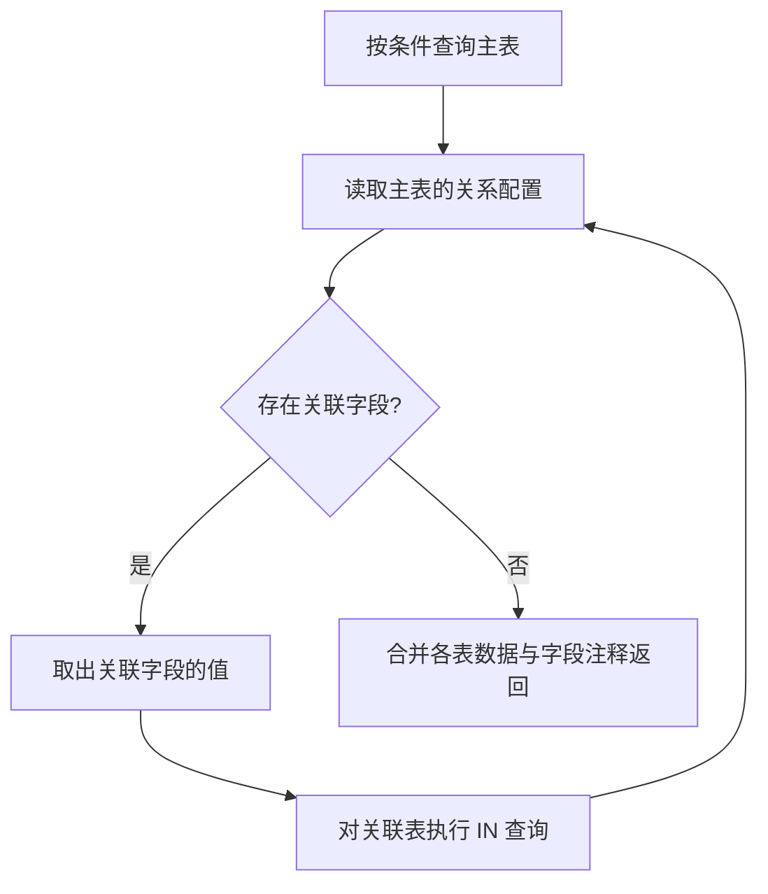
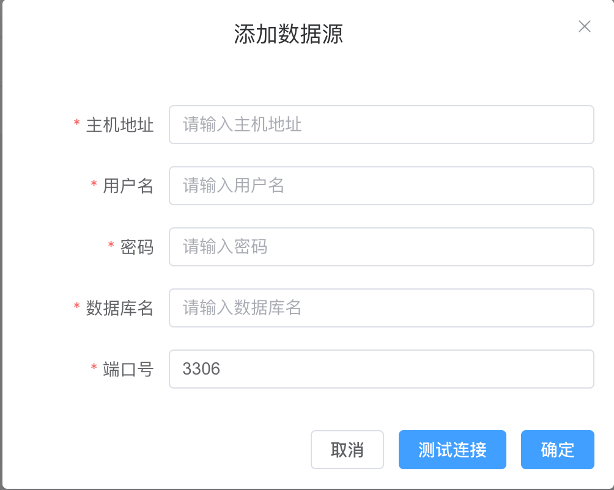
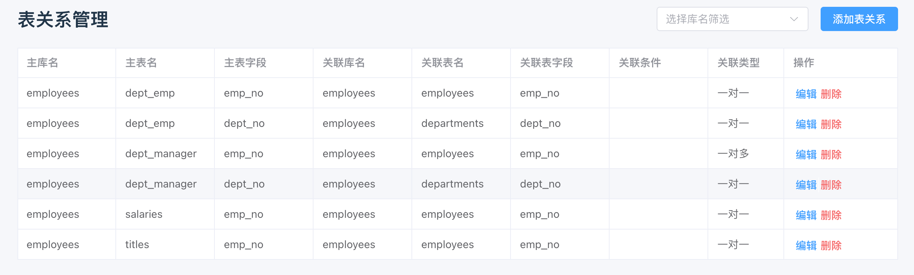
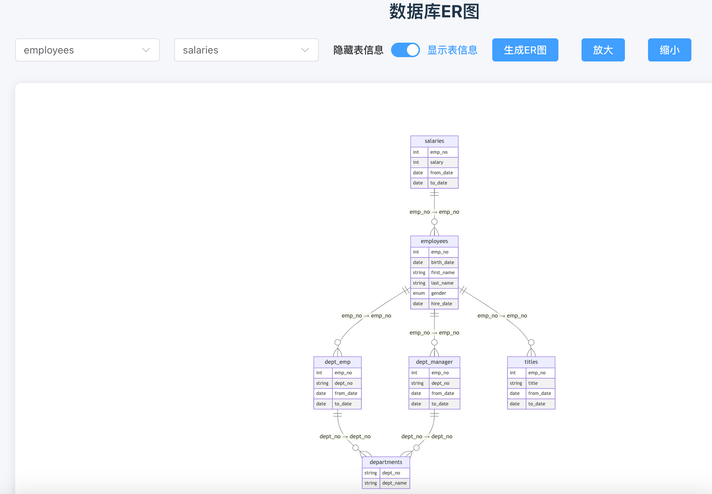

# Table Relation

> 按表关系自动展开数据的轻量级查询工具：配好关系，输入一个主键，关联表的数据一次带出来。

[](https://github.com/zavier/table-relation/actions/workflows/maven.yml)




## 这个工具解决什么问题

排查业务数据时，一张主表往往挂着订单、明细、用户、商品、日志等好几张关联表。为了看一眼完整数据，通常要手写多表 `JOIN`，或者按外键一条条查，改条件、换主键时还要反复重写。

Table Relation 把「表关系」变成一次性的配置：

- 添加数据源后，自动读取外键并生成关系，也可以手动补充没有外键的关联；
- 查询时只需要指定主表和条件，工具会按关系自动展开所有关联表的数据；
- 关系上可以附加条件（如 `status = PAID`），用来处理「同一张日志表按 type 区分来源」这类场景。

它不是 SQL 客户端的替代品，而是面向「快速查看一条业务数据的完整链路」这一件事。

## 功能特性

| 能力 | 说明 |
|---|---|
| 多数据源 | 同时管理 MySQL 与 PostgreSQL，按类型生成连接串 |
| 表关系 | 外键自动导入，支持手动维护、关系类型、结构化关联条件 |
| 联合查询 | 基于关系图做 BFS 展开，主表 + 多级关联表一次返回 |
| 列注释 | 查询结果与 ER 图会带上表/字段注释，便于理解业务含义 |
| ER 图 | 基于 Mermaid 渲染，展示表结构与字段关系 |
| 结果导出 | 一键复制 JSON 结果，或生成可执行的 `INSERT` SQL |
| AI 关系分析（可选） | 库中没有外键时，可调用 DeepSeek 推断表关系 |
| 本地部署 | 一个 jar 包含前后端，元数据默认存放在内嵌 SQLite |
| 深色模式 | 自动跟随系统深浅色偏好 |

## 工作原理



一次联合查询的流程：



- 每个表最多返回 `sql.query.count.max` 条（默认 10），避免误查大表；
- 关系展开按「表 + 字段」去重，循环关系不会无限递归；
- 查询条件、`IN` 列表、关系条件全部使用 JDBC 参数绑定，不拼接用户输入。

## 快速开始

### 环境要求

- JDK 21+
- 构建前端需要 Node.js 20+（由 `frontend-maven-plugin` 自动下载，无需手动安装）

### 构建并运行

```bash
git clone https://github.com/zavier/table-relation.git
cd table-relation

# 后端 + 前端一起打包，产物是带 UI 的 jar
./mvnw clean package

java -jar target/table-relation-*.jar
```

打开 <http://localhost:8080> 即可使用。

需要换端口时：

```bash
java -jar target/table-relation-*.jar --server.port=9090
```

只编译/测试后端、跳过前端构建：

```bash
./mvnw package -P '!frontend'
```

> [Releases](https://github.com/zavier/table-relation/releases) 页面提供历史版本的构建产物，可能落后于 `main`；体验最新功能建议从源码构建。

## 使用指南

### 1. 添加数据源



在「数据源管理」中填写主机、端口、用户名、密码、数据库名，并选择数据库类型：

- **MySQL**：`数据库名` 填库名，端口默认 3306
- **PostgreSQL**：`数据库名` 填数据库名，`Schema` 默认 `public`，端口默认 5432

保存前可以先「测试连接」。保存后工具会读取该库的表、字段、注释和外键，并自动生成关系。


### 2. 维护表关系



外键关系会自动导入；没有外键的场景可以手动添加。


「关联条件」用于一张表按条件关联不同表的场景。例如操作日志表用 `type` 字段区分来源表，可以配置 `type = 1`。条件由「字段 + 运算符 + 值」组成，和查询条件一样参数化执行。

### 3. 查看 ER 图



选择库和表后，会展示该表及其关联表的字段、类型、注释和关系走向，适合在查询前确认关系配置是否正确。

### 4. 查询数据


选择库、表和条件后执行查询：

- 主表数据单独展示，关联表数据按表分组展示，均支持表格 / JSON 两种模式；
- 条件运算符支持 `=`、`!=`、`>`、`<`、`LIKE`，多个条件之间为 `AND`；
- 列头悬浮可查看数据库中的字段注释；
- 「复制 JSON 结果」用于快速分享；「复制 SQL 结果」会生成对应的 `INSERT` 语句，便于造数或迁移。

## 支持的数据库

| 数据库 | 必填项 | 端口 | 说明 |
|---|---|---|---|
| MySQL | host、port、database、username、password | 3306 | `database` 即库名 |
| PostgreSQL | host、port、database、schema、username、password | 5432 | 一个数据源绑定一个 schema，默认 `public` |

PostgreSQL 相关限制：

1. 同一数据库的多个 schema 需要分别添加数据源（当前版本一个数据源对应一个 schema）；
2. 跨 schema 的外键不会自动导入，需要手动维护关系；
3. 应用自身的元数据默认存放在 SQLite，PostgreSQL 只作为被查询的数据源。

## 配置说明

`src/main/resources/application.properties` 中常用配置：

| 配置项 | 默认值 | 说明 |
|---|---|---|
| `spring.datasource.url` | `jdbc:sqlite:table_database.db` | 应用元数据库（数据源、关系配置） |
| `spring.sql.init.schema-locations` | `classpath:sqlite_create_table.sql` | 元数据库建表脚本 |
| `sql.query.count.max` | `10` | 每张表最多返回的条数 |
| `logic.no.delete.condition` | 空 | 附加到每次数据查询的过滤条件，如 `deleted = 0`；属于可信配置，请勿填写外部输入 |
| `analyze.column.usage.auto` | `false` | 是否在无外键时调用大模型分析关系 |
| `spring.ai.openai.api-key` | 占位值 | 启用大模型分析时填写 DeepSeek API Key |

### 使用 MySQL 作为应用元数据库

默认的 SQLite 适合本地单机使用；也可以切换到 MySQL：

```properties
spring.datasource.url=jdbc:mysql://localhost:3306/table_manager?useUnicode=true&characterEncoding=utf-8&useSSL=false
spring.datasource.driver-class-name=com.mysql.cj.jdbc.Driver
spring.datasource.username=root
spring.datasource.password=your_password
spring.sql.init.schema-locations=classpath:mysql_create_table.sql
```

启动时会自动补齐新增字段，已有 SQLite / MySQL 元数据库无需手工迁移。

## 本地开发

### 前端

```bash
cd frontend
npm install
npm run dev
```

开发服务器会把 `/api` 代理到 `http://localhost:8080`。

### 后端

```bash
./mvnw spring-boot:run
```

### 质量检查

```bash
cd frontend
npm run lint          # ESLint
npm run format:check  # Prettier 格式检查
npm run test          # Vitest 单元测试

cd ..
./mvnw test           # 后端单元测试
```

CI 会在每次 PR 时依次执行 `npm ci → lint → format:check → test → mvn package`。

### PostgreSQL 验证环境

仓库自带演示用的 compose 与样例数据（带注释、外键、`jsonb`、数组、跨 schema 外键）：

```bash
docker compose -f docker/pg/docker-compose.yml up -d
```

连接信息：`127.0.0.1:5544`、数据库 `shop`、用户 `postgres`、密码 `postgres`、schema `public` 或 `sales`。

### 项目结构

```
.
├── frontend/                  # Vue 3 + Vite + Element Plus
├── src/main/java/.../dao       # 元数据存储、SQLite/MySQL 迁移
├── src/main/java/.../service   # 查询、关系注册、数据库适配器
├── src/main/java/.../manager   # 业务编排
├── src/main/java/.../web       # REST API
├── docs/specs/                 # 设计与改造文档
├── docker/pg/                  # PostgreSQL 演示环境
└── pom.xml                     # Maven 构建，默认包含前端
```

## 设计文档

- [PostgreSQL 数据源支持](docs/specs/2026-11-24-postgresql-support-design.md)
- [查询条件参数化](docs/specs/2026-11-24-parameterized-query.md)
- [表关系关联条件结构化](docs/specs/2026-11-24-structured-relation-condition.md)
- [前端工程化 TODO](docs/frontend-todo.md)

## Roadmap

- [ ] 多 schema：同一 PostgreSQL 数据库下的多个 schema 同时挂载
- [ ] 跨 schema 外键自动导入
- [ ] 一个表关系支持多条条件
- [ ] Testcontainers 集成测试
- [ ] 前端 TypeScript 迁移与组件拆分

## 安全说明

- 项目没有做鉴权，建议只在本地或可信内网使用；
- 查询条件值、`IN` 列表、表关系条件均使用参数绑定，运算符有白名单校验；
- `logic.no.delete.condition` 是部署方维护的原始 SQL 片段，属于可信配置，请勿拼接外部输入。

## 贡献

欢迎提交 Issue 和 Pull Request。提交前请确保：

1. `npm run lint`、`npm run format:check`、`npm run test` 通过；
2. `./mvnw test` 通过；
3. 涉及数据库方言的改动补充对应单元测试，必要时用 `docker/pg` 环境验证。

## 许可证

仓库目前尚未包含 LICENSE 文件。在补充许可证之前，默认保留所有权利；如需在公司内部分发或商业使用，请先与作者联系。
