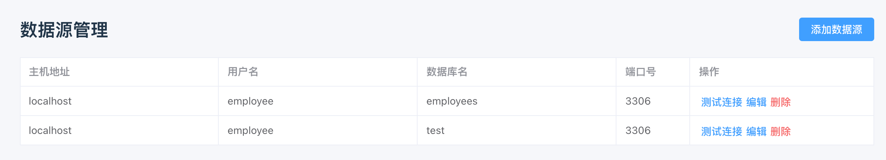
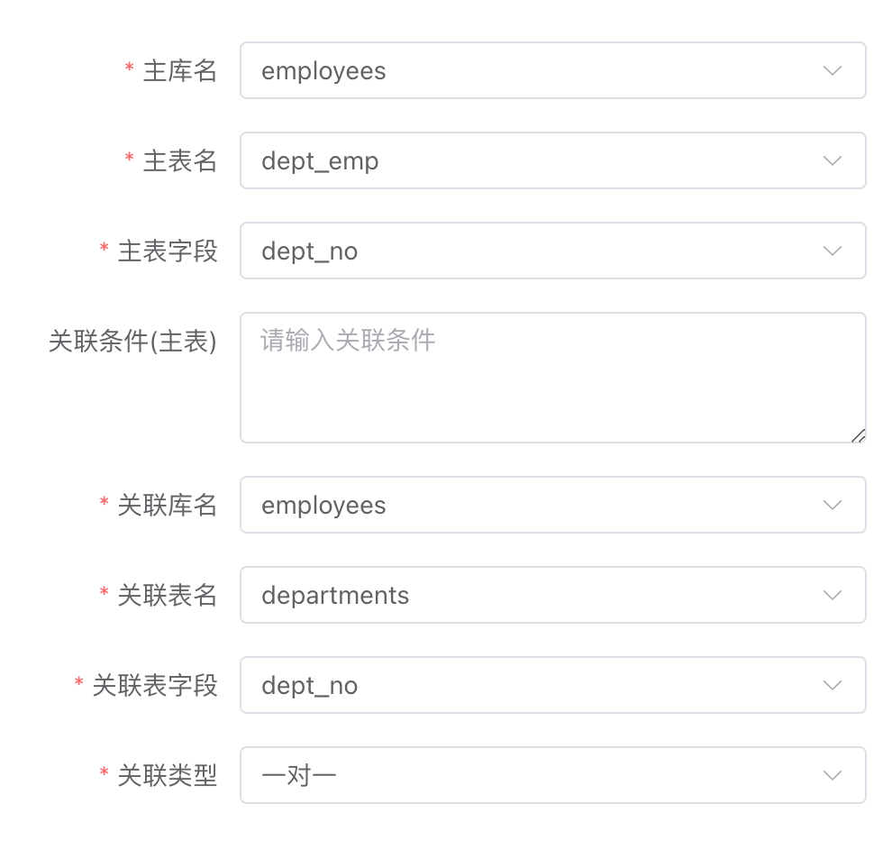

对于复杂的一些业务，会涉及很多张表，其间有各种各样的关联关系，在开发&测试过程中，随时需要查看这些表中的数据状态，这种情况下需要我们写一些关联查询的SQL或者多条SQL执行来查看结果，个人感觉用起来还是不太方便，所以想开发一个关联表自动进行查询的工具

后端基于spring boot自行开发；前端部分使用了Trae，让大模型来进行的开发～

前端源码位于本仓库 `frontend/` 目录（Vue 3 + Vite + Element Plus），不再单独维护前端仓库。

服务主要还是本地部署个人使用，为了简化，本地数据库使用了sqlite的文件形式存储；前端构建产物由 Maven 在打包时自动生成并打入 jar，所以没有其他外部依赖

打包后通过 `java -jar xxx.jar` 执行，直接访问 `http://localhost:8080/` 即可使用

注意：

1. 需要 jdk 版本大于等于 21；打包时需要 Node.js 20+（由 frontend-maven-plugin 自动下载，无需手动安装）

2. 没有做鉴权；查询条件值已使用参数化查询，但表关系中的「关联条件」是原始 SQL 片段，请只填写可信内容，所以只建议本地安装个人使用

### 本地开发

前端开发（热更新，`/api` 代理到 `localhost:8080`）：

```bash
cd frontend
npm install
npm run dev
```

前端代码检查：

```bash
npm run lint          # ESLint
npm run format        # Prettier 自动格式化
npm run format:check  # 仅检查格式（CI 使用）
npm run test          # Vitest 单元测试
```

后端开发（不构建前端，页面通过上面的前端 dev server 访问）：

```bash
./mvnw spring-boot:run
```

一条命令打包（后端 + 前端，产出带 UI 的 jar）：

```bash
./mvnw clean package
```

如果只想编译/测试后端、跳过前端构建，可显式关闭 profile：

```bash
./mvnw package -P '!frontend'
```

产物为 `target/table-relation-*.jar`。

下面进行一下对应功能介绍

### 数据源管理

用来管理数据库的连接（需要服务所在的机器可以连接到数据库）

目前支持 **MySQL** 与 **PostgreSQL** 两种数据源，可以同时存在、混合使用：

- MySQL：`数据库名` 即库名，端口默认 3306
- PostgreSQL：`数据库名` 填数据库名，`Schema` 默认 `public`，端口默认 5432

PostgreSQL 使用注意：

1. 一个数据源绑定一个 schema；同一数据库的多个 schema 需要新增数据源（当前版本只支持单 schema）
2. 跨 schema 的外键不会自动导入，需要手动维护关系
3. 应用自身的元数据仍存放在 SQLite / MySQL 中，PostgreSQL 仅作为被查询的数据源

设计说明见 [docs/specs/2026-11-24-postgresql-support-design.md](docs/specs/2026-11-24-postgresql-support-design.md)



### 表字段关系管理

这里主要进行字段关系的维护，如果使用了外键的话，其实是可以自动同步外键配置的，不过目前项目中使用较少，所以没有进行支持实现，后续可考虑增加此功能


比如员工表(employees)的部门编码字段(dept_no)对应了，部门表(departments)的(dept_no)字段，那么我们可以这样配置（主表可以理解为包含类似外键的表）

其中的关联条件部分，使用场景为一张表根据条件关联不同的表

假设有多张表，它们的操作日志都记录在了一个叫做操作日志的表里面，同时操作日志表有一个类型字段来区分对应的表是哪个，那么我们可以在关联条件中输入对应的条件即可，如（type=1），如果没有这种场景就可以不填写




### ER图查看

在创建好数据源以及维护好字段关系后，我们可以通过查看ER图来确认一下配置是否正确

需要输入一下对应的db和table即可，会查找所有关联的表进行展示，并同时展示关联的字段关系


### 数据查询

最后就是数据的查询，选择db和表后，需要输入对应的查询条件，这时会查询对应的数据，同时会将关联的表和数据同时在下方进行展示（目前限制了单表数据最多10条）


### 后续TODO
- [ ] 建立字段关系，同步关联更新
- [ ] 支持分库分表
- [ ] 前端工程化改造，详见 [docs/frontend-todo.md](docs/frontend-todo.md)
